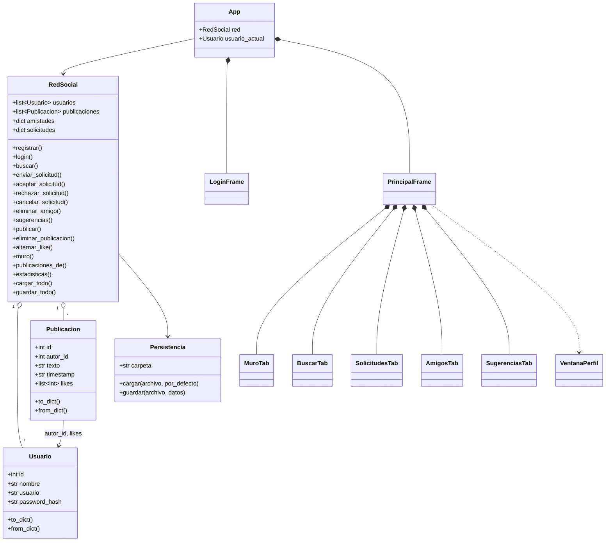

# Estructuras-3P-RedSocial
# UniConecta – Red social estudiantil

Python 3.9+ · Tkinter (incluido con Python) · Persistencia en JSON. Sin dependencias externas.

## Ejecutar
```
python generar_datos_prueba.py   # opcional: restaura los datos de prueba
python main.py
```
(En Linux, si falta Tkinter: `sudo apt install python3-tk`)

## Usuarios de prueba (contraseña de todos: `1234`)
| Usuario | Nombre          | Amigos        | Solicitudes pendientes |
|---------|-----------------|---------------|------------------------|
| ana     | Ana Martínez    | carlos, lucia | recibe de valeria      |
| carlos  | Carlos Rojas    | ana, diego    |                        |
| lucia   | Lucía Fernández | ana           | recibe de diego        |
| diego   | Diego Vargas    | carlos        | envió a lucia          |
| valeria | Valeria Soto    | (ninguno)     | envió a ana            |

## Funcionalidades
- Registro e inicio de sesión (validado contra archivos).
- Muro con publicaciones propias y de amigos, de la más reciente a la más antigua.
- Buscador de usuarios y **solicitudes de amistad** (enviar, aceptar, rechazar, cancelar).
- **Me gusta** (se puede quitar) y **eliminar** publicaciones propias.
- **Sugerencias de amigos** ("amigos de tus amigos") recorriendo el grafo.
- **Perfil** de otro usuario con solo sus publicaciones.
- **Contadores** de amigos, publicaciones y solicitudes en la barra superior.

## Estructura
| Archivo | Función |
|---|---|
| `main.py` | Punto de entrada |
| `gui.py` | Ventanas: login, registro, muro, buscador, solicitudes, amigos, sugerencias, perfil |
| `red.py` | Lógica de negocio y estructuras en memoria |
| `modelos.py` | Clases `Usuario` y `Publicacion` |
| `persistencia.py` | Lectura/escritura de JSON (escritura atómica) |
| `generar_datos_prueba.py` | Crea los datos de prueba |
| `datos/` | `usuarios.json`, `publicaciones.json`, `amistades.json`, `solicitudes.json` |

## Estructuras de datos
- `usuarios: list[Usuario]` – catálogo de usuarios.
- `publicaciones: list[Publicacion]` – historial (cada una guarda la lista de ids que dieron me gusta).
- `amistades: dict[int, set[int]]` – **grafo no dirigido como lista de adyacencia**; cada amistad crea la arista en ambos sentidos.
- `solicitudes: dict[int, set[int]]` – solicitudes pendientes `{receptor: {emisores}}` (aristas dirigidas aún no confirmadas).
- `_por_id: dict[int, Usuario]` – índice para acceso O(1).

## Algoritmo de sugerencias
Para cada amigo del usuario se recorren sus vecinos en el grafo (distancia 2). Se descartan el propio usuario, sus amigos y quienes ya tienen una solicitud pendiente con él, y se cuenta cuántos amigos en común tiene cada candidato. Se ordena por más amigos en común.

## Persistencia
Al iniciar, `RedSocial` lee los 4 JSON y reconstruye las estructuras. Se guarda tras cada cambio y al cerrar. Si los archivos no existen, arranca vacío (los datos antiguos sin `likes` o sin `solicitudes.json` también se cargan bien). Las contraseñas se guardan con hash SHA-256.

## Diagrama de clases (UML)
